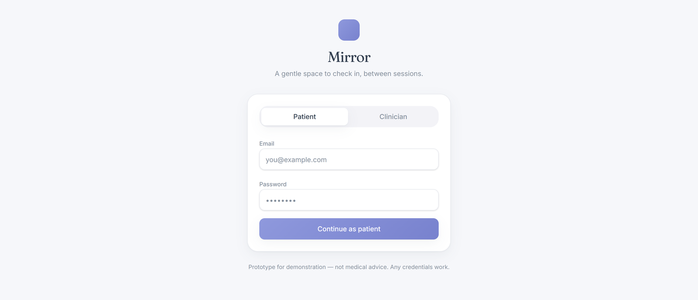
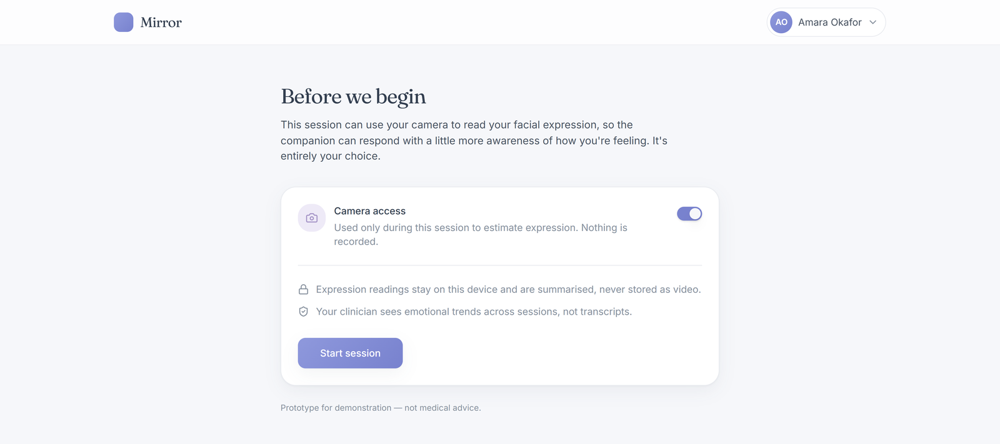
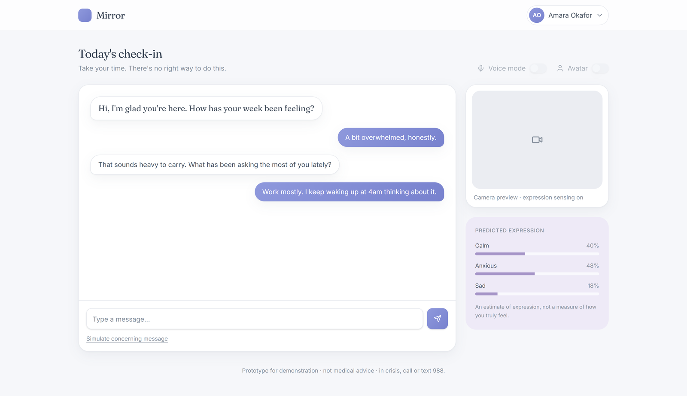
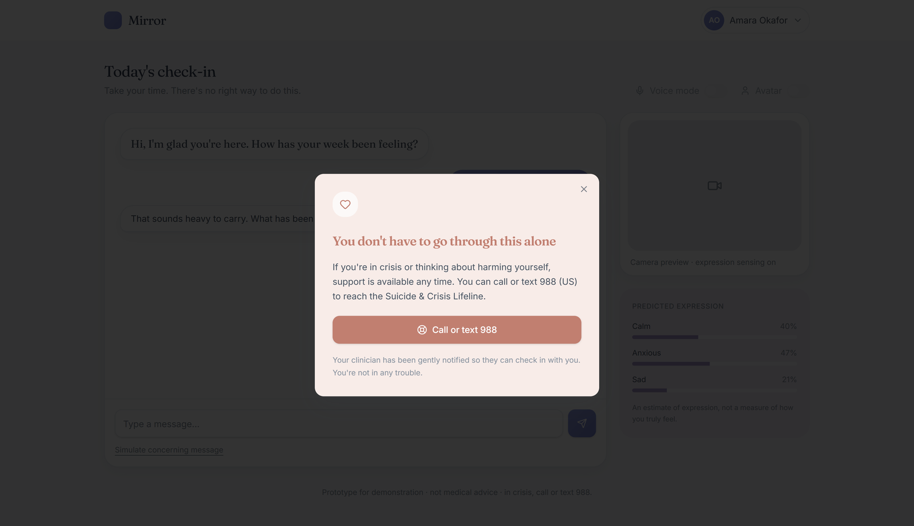
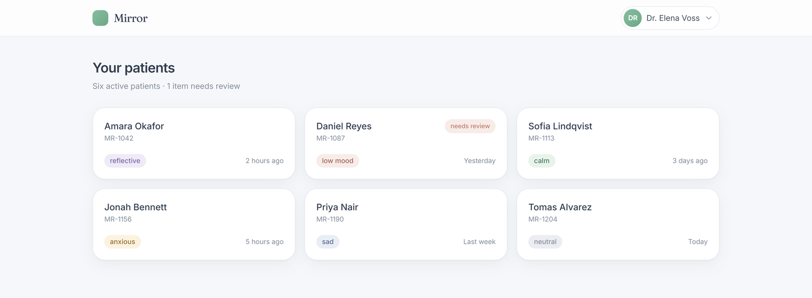
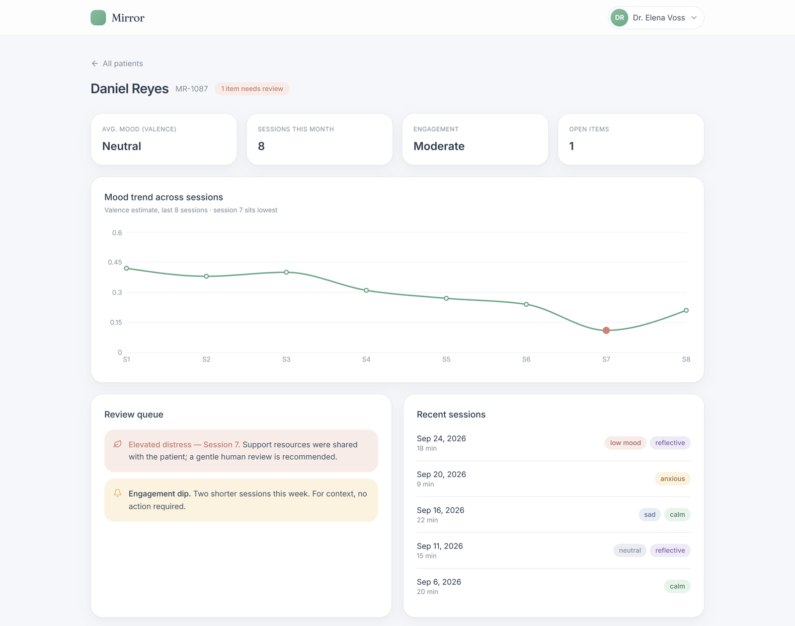
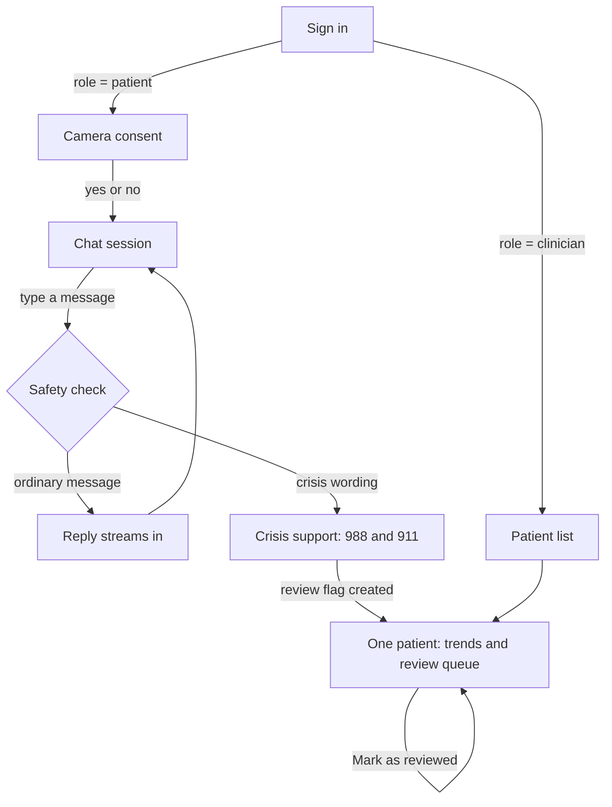
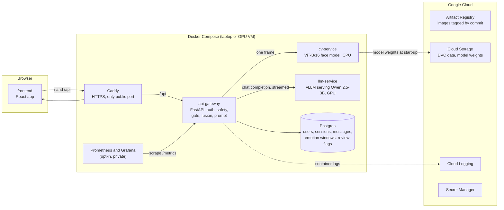
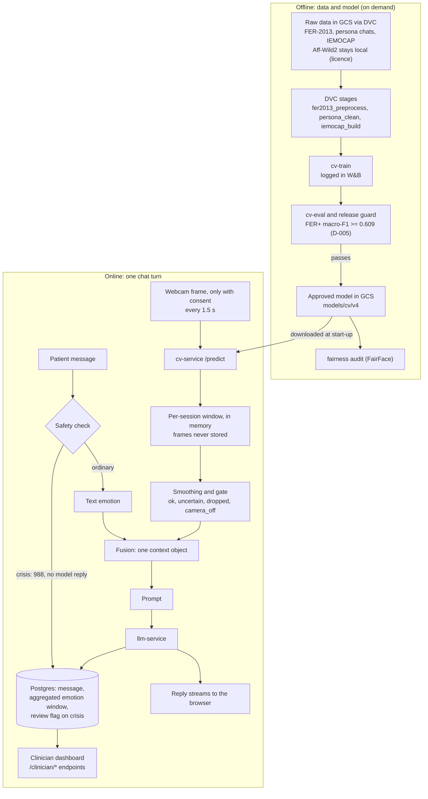
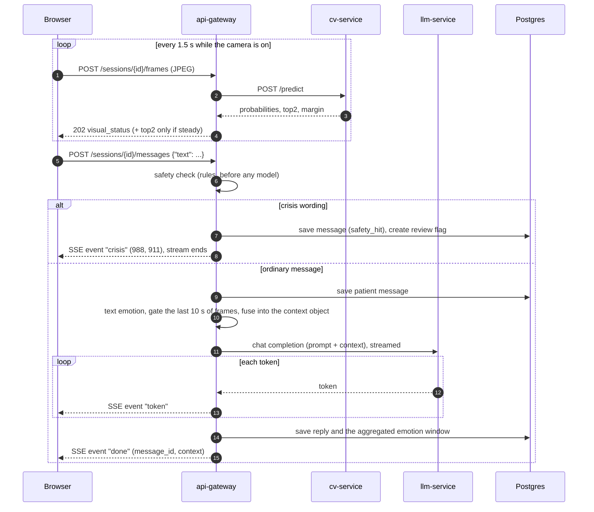

# Mirror: application design (MS4)

This document covers MS4 Deliverable 1. It brings together the user interface, the architecture, the data flow, one request step by step, the API and the code layout. The detailed sources stay where they are and are linked from each section: [architecture](architecture.md), [contracts](contracts/), [data model](data-model.md), [decisions](decisions.md) and [mock-ups](mockup/README.md).

Mirror is a prototype, not a clinical product. A patient chats with a supportive persona. With consent, their webcam gives a facial-expression signal and their words give a tone signal. Both are combined into one short, uncertainty-labelled note per message, and that note shapes the reply. A rule-based safety check runs before the model. A clinician sees each patient's trends and anything that needs a review.

## Contents

1. [User interface and user flows](#1-user-interface-and-user-flows)
2. [Solution architecture](#2-solution-architecture)
3. [Technical architecture](#3-technical-architecture)
4. [Data flow](#4-data-flow)
5. [Sequence diagram: one chat message](#5-sequence-diagram-one-chat-message)
6. [API contract summary](#6-api-contract-summary)
7. [Code organisation](#7-code-organisation)

---

## 1. User interface and user flows

### Screens

The screens started as the MS1 clickable prototype and are now the working app in `services/frontend`.

| Screen | Route | What it does |
|---|---|---|
|  **Sign in** | `/` | One login for both roles. The gateway returns the role, and the app opens the patient or the clinician side. |
|  **Camera consent** | `/consent` | The camera stays off unless the patient opts in. The choice is stored on the session. |
|  **Chat session** | `/session` | The reply streams in word by word. A side panel shows the camera's steady reading, or "uncertain" or "camera off". |
|  **Crisis support** | `/session` (dialog) | Replaces the reply when the safety check fires: 988 and 911, and the clinician is flagged. |
|  **Clinician: patients** | `/clinician` | The clinician's own patients, the last session and a "needs review" marker. |
|  **Clinician: one patient** | `/clinician/{patient_id}` | Review queue with "Mark as reviewed", a day-by-day chart of how messages read, and the camera estimate per day. |

**Changed after MS1 feedback:** the clinician mock-ups above show labels such as "anxious" and "low mood". The real dashboard (M4-01) shows **expression and wording estimates with a confidence level** instead, for example "tense-looking · low confidence · an estimate, not a feeling". The models estimate expressions and wording; they cannot measure feelings.

Every screen has a loading state, a visible error state (with "log in again" for an expired login) and an empty state.

### Primary user flows



**Patient flow:** sign in, choose whether the camera is on, chat. Each message gets a streamed reply. A crisis message gets the crisis screen instead and flags the clinician. A question about medication or about the camera gets a fixed, safe reply.

**Clinician flow:** sign in, see the patient list, open one patient, read the estimates and mark open review items as reviewed.

---

## 2. Solution architecture



| Component | Owner | What it does |
|---|---|---|
| frontend | Mostafa (shell, dashboard), Julie (chat), Owen (webcam) | Every screen; talks only to the gateway |
| api-gateway | Mostafa | The orchestrator: login and roles, safety check, text emotion, smoothing and gating of camera readings, fusion into one context object, the prompt, streaming the reply, saving aggregates |
| cv-service | Owen (serving), Mostafa (model) | Face-expression model v4 behind `/predict` |
| llm-service | Owen | vLLM serving plain Qwen 2.5-3B-Instruct (decision D-006), OpenAI-compatible API |
| db | Owen | Postgres. Never stores camera frames |
| Prometheus and Grafana | Julie | Gateway metrics dashboard, opt-in Compose profile, not public |

**Where it runs.** Locally, one command starts the stack with no setup (`docker compose -f infra/compose.yml up --build`; the LLM runs as a mock without a GPU). For the deployed demo, the same Compose file plus `compose.prod.yml` runs on one GCP VM with an NVIDIA L4, using images from Artifact Registry tagged by commit. MS5 moves this to Kubernetes (GKE).

**Jobs that run on demand** (not always-on services): data preprocessing (DVC stages), cv-train, cv-eval with the release guard, the fairness audit, llm-finetune on Vertex AI, and the evaluation harnesses. They are tracked in Weights & Biases.

---

## 3. Technical architecture

### Technologies

| Layer | Technology | Why |
|---|---|---|
| Frontend | React 19, TanStack Start and Router, TanStack Query, Tailwind CSS 4, Radix UI (shadcn), Recharts, Vite | File-based routes; Query gives loading, error and refresh states; accessible UI components |
| API | FastAPI (Python 3.11), Pydantic, Server-Sent Events | Typed request and response models that generate the OpenAPI docs; SSE streams the reply word by word |
| Auth | bcrypt hashes in Postgres, short-lived HS256 JWT carrying the role | One login for both roles; the role comes from the database, never from the browser |
| Face model | PyTorch ViT-B/16, retrained on Aff-Wild2 video frames and FER+ labels (v4) | Best video macro-F1 of our runs (0.337), FER+ 0.720 |
| Text emotion | j-hartmann DistilRoBERTa (D-003) | Same seven emotions as the face model, runs on CPU |
| Language model | Qwen 2.5-3B-Instruct on vLLM | Fits one GPU; plain model chosen over our adapter by hand-read evaluation (D-006) |
| Database | PostgreSQL 16 | Relational data with foreign keys and ownership checks in SQL |
| Data and models | DVC with a GCS remote; W&B for experiments | Reproducible data by hash; every run traceable |
| Packaging | Docker, one uv project per Python component, Docker Compose | One command locally; the same images in production |
| CI | GitHub Actions | Path-filtered jobs per component, a required `CI summary` check |
| Cloud | GCE GPU VM, Artifact Registry, Cloud Storage, Cloud Logging, Secret Manager | See [infra/README.md](../infra/README.md) |

### Design patterns

| Pattern | Where | Why |
|---|---|---|
| **API gateway / orchestrator** | `services/api-gateway` | The browser talks to one service. The model services stay simple and never see the browser |
| **Contracts first** | `docs/contracts/*.openapi.yaml`, `context_object.schema.json`, validated in CI | Three people build in parallel against the same shapes; a mismatch fails CI |
| **Safety first, fail closed** | `app/safety.py` runs before any model | A crisis message never reaches the language model; the same message always gets the same answer |
| **Pipeline of small pure steps** | `safety` → `text_emotion` → `gating` → `fusion` → `prompt` in `app/orchestration.py` | Each step is testable on its own (162 safety cases, gate sweep, fusion rules) |
| **Repository pattern** | `app/repository.py`, `app/clinician.py` | SQL lives behind one interface; tests use a fake; ownership is enforced in every query |
| **Dependency injection** | FastAPI `Depends` for settings, the current user and repositories | Role checks and test doubles without global state |
| **Streaming events** | SSE events `crisis`, `token`, `done` | One code path in the frontend for every outcome |
| **Graceful fallback** | camera off, cv-service down, low confidence | The turn still gets a text-only reply |
| **Immutable deployments** | images tagged with the git SHA, pulled by tag on the VM | What runs is exactly what was reviewed |

---

## 4. Data flow

Two flows: the **offline** flow builds the face model, and the **online** flow handles each message. They meet at Cloud Storage, where the approved model lives.



**What is stored and what is not.** Messages, aggregated emotion windows (the gate status and top-two estimates per message) and review flags are stored in Postgres. Camera frames never are: they live in an in-memory window for a few seconds and are dropped. Logs record the rule name of a safety hit, never the message.

---

## 5. Sequence diagram: one chat message

The patient has the camera on and sends a message. Frames have been arriving in the background.



A medication or camera question follows the ordinary path but gets a fixed reply instead of calling the language model. If cv-service is down, the frame call returns 503 and the turn goes ahead on text alone.

---

## 6. API contract summary

The full contracts are in [`docs/contracts/api-gateway.openapi.yaml`](contracts/api-gateway.openapi.yaml), and a running gateway serves them at `/docs`. All endpoints except `/health` and `/auth/login` need `Authorization: Bearer <token>`.

### api-gateway (public, behind Caddy at `/api`)

| Method and path | Role | Request | Response |
|---|---|---|---|
| `GET /health` | anyone | none | `{"status", "dependencies": {...}}` |
| `POST /auth/login` | anyone | `{"email", "password"}` | `{"access_token", "role", "user_id"}`. 401 on a wrong password; 429 after 5 wrong tries in 5 minutes (per email and address) |
| `POST /auth/refresh` | logged in | none | a new token, same shape as login |
| `POST /sessions` | patient | `{"camera_consent": bool}` | `{"session_id", "started_at", "camera_consent"}` |
| `POST /sessions/{id}/frames` | patient, own session | multipart `image` (JPEG, max 1 MB) | 202 `{"visual_status", "top2"?}`. 403 not your session, 409 no consent, 413 too large, 415 not JPEG, 503 camera analysis down |
| `POST /sessions/{id}/messages` | patient, own session | `{"text"}` (1-4000 characters) | SSE stream: `token` events then `done` `{"message_id", "context"}`, or one `crisis` event `{"message", "resources", "review_flag_created"}` |
| `GET /clinician/patients` | clinician | none | `[{"patient_id", "display_name", "last_session_at", "needs_review"}]`, own patients only |
| `GET /clinician/patients/{id}/trend` | clinician, own patient | none | `[{"ts", "visual_status", "visual_top2", "text_top2", "tone_mode"}]`. 403 for another clinician's patient |
| `GET /clinician/patients/{id}/review-flags` | clinician, own patient | none | `[{"flag_id", "created_at", "reviewed_at"}]`, never the message text |
| `PATCH /clinician/review-flags/{id}` | clinician, own patient | `{"reviewed": true}` | `{"reviewed": true}` |

### Internal services (private Docker network only)

| Service | Endpoint | Request | Response |
|---|---|---|---|
| cv-service | `POST /predict` | multipart `image` | `{"face_found", "probs", "top2", "margin", "uncertain", "model_version", "latency_ms"}` |
| cv-service | `POST /predict_batch` | several images | `{"predictions": [...]}` in request order (offline evaluation) |
| llm-service | `POST /v1/chat/completions` | OpenAI chat format, `stream: true` | OpenAI streamed chunks |

The context object passed into the prompt has its own schema: [`context_object.schema.json`](contracts/context_object.schema.json).

---

## 7. Code organisation

The repository separates the **frontend**, the **backend services** and the **data science jobs**, and every Python component is its own uv project with its own tests, Dockerfile and CI job.

```text
AC215_Mirror/
├── services/                  long-running containers (the application)
│   ├── frontend/              React app: routes/ (screens), lib/api/ (the only code that calls the API),
│   │                          lib/ (camera, chat, clinician helpers), components/
│   ├── api-gateway/           FastAPI: app/auth.py, chat.py, clinician.py, safety.py, text_emotion.py,
│   │                          gating.py, fusion.py, prompt.py, orchestration.py, repository.py
│   ├── cv-service/            face-model serving (/predict)
│   ├── llm-service/           vLLM image (real) and a mock for laptops and CI
│   ├── db/                    init.sql (schema), seed.sh, demo-history.sql
│   └── _template/             starting point for a new service
├── pipelines/                 data science jobs, run on demand
│   ├── data-preprocess/  persona-data/  iemocap-data/     DVC data stages
│   ├── cv-train/  cv-eval/  fairness-audit/               face model: train, evaluate, audit
│   ├── llm-finetune/  llm-eval/  modality-eval/           language model: fine-tune and evaluate
├── infra/                     compose.yml (local), compose.prod.yml (VM), caddy/, monitoring/, gcp/, tests/
├── docs/                      this document, architecture, contracts/, decisions, model cards, evidence
├── tests/                     end-to-end (M4-05) and load (M4-07) tests
├── dvc.yaml  dvc.lock         the data pipeline
└── .github/workflows/         CI (ci.yml) and image publishing
```

**Rules that keep it clean:**
- The frontend never calls `fetch` outside `lib/api/client.ts`, and the types there mirror the OpenAPI contract.
- Model code never runs in the gateway's request path except through the cv-service and llm-service APIs. The text-emotion model is the one exception, loaded once at start-up.
- Data science jobs do not import service code. They share data through DVC and models through GCS.
- Every decision that changes behaviour is recorded in [`decisions.md`](decisions.md) (D-003 text model, D-004 disagreement check-in, D-005 FER+ guard, D-006 plain Qwen).
