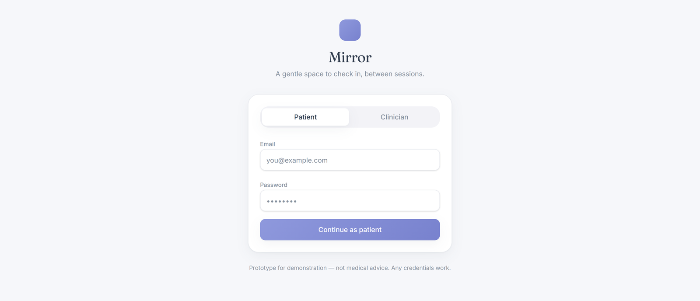
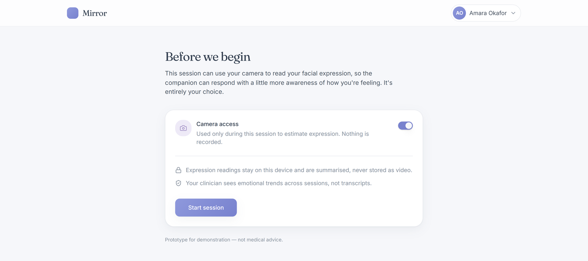
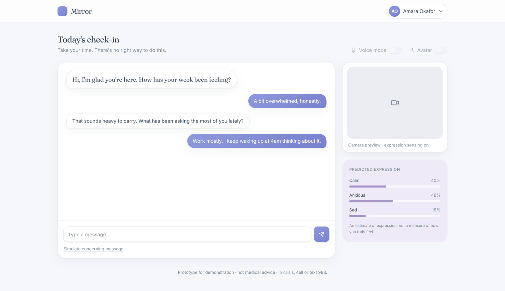
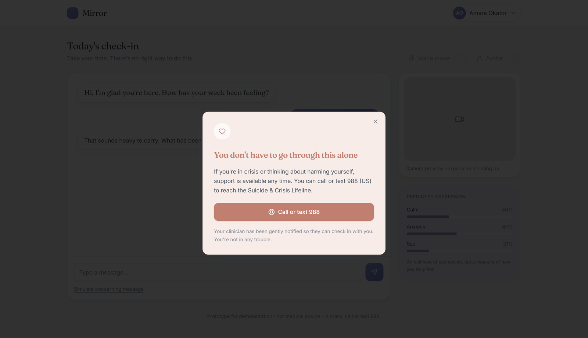
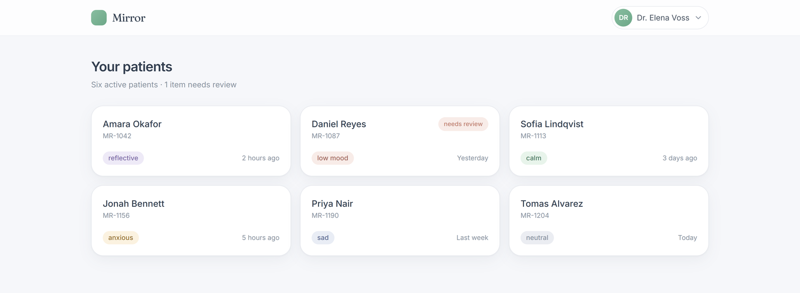
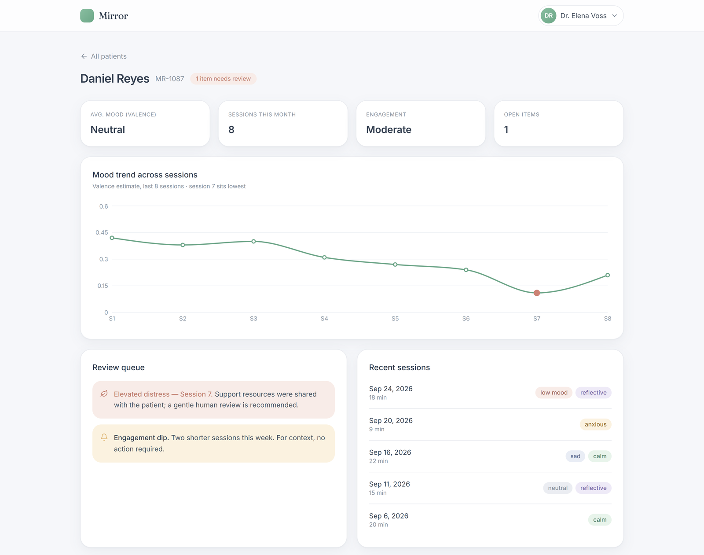
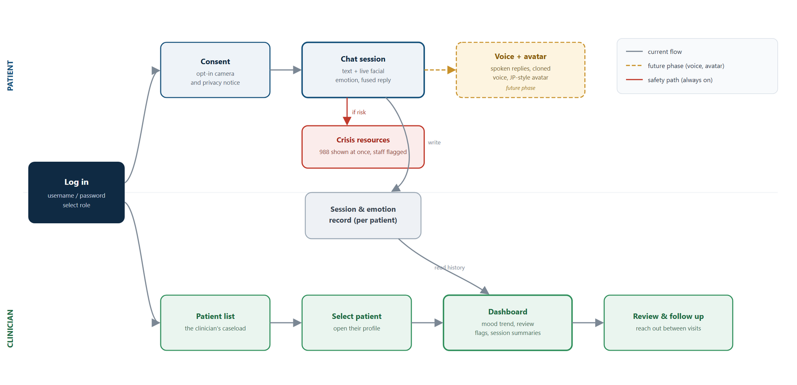

# Application mock-up (MS1 design → MS2 app skeleton)

These screens come from the MS1 clickable prototype (built in Lovable). The working MS2 app skeleton in `services/frontend` is built from them: sign-in, consent and the chat session already talk to the real API gateway (login with a token, camera consent, a streamed reply). The clinician screens arrive in MS4 (M4-01).

| Screen | Status in the app skeleton |
|---|---|
|  **Sign in**: patient or clinician | ✅ Real login against the gateway (token) |
|  **Consent**: camera off unless the user says yes | ✅ Consent passed to the session (`camera=true` only on opt-in) |
|  **Session**: chat + expression panel | ✅ Reply streams from the gateway (SSE); expression panel shows an explicit "camera off" state without consent |
|  **Crisis support**: 988 + clinician notified | ⏳ MS3 (M3-07 crisis check, M3-12 chat UI) |
|  **Clinician: patient list** | ⏳ MS4 (M4-01) |
|  **Clinician: one patient's trend + review queue** | ⏳ MS4 (M4-01) |
|  **User flow**: patient and clinician paths | Reference |

**Changed after MS1 feedback:** the clinician screens here show labels such as "anxious" and "low mood". In the real dashboard (M4-01) these become **expression estimates with a confidence level** ("tense-looking · low confidence · an estimate, not a feeling"). The face model cannot reliably measure how someone feels, so it must not present its output as a clinical fact.
