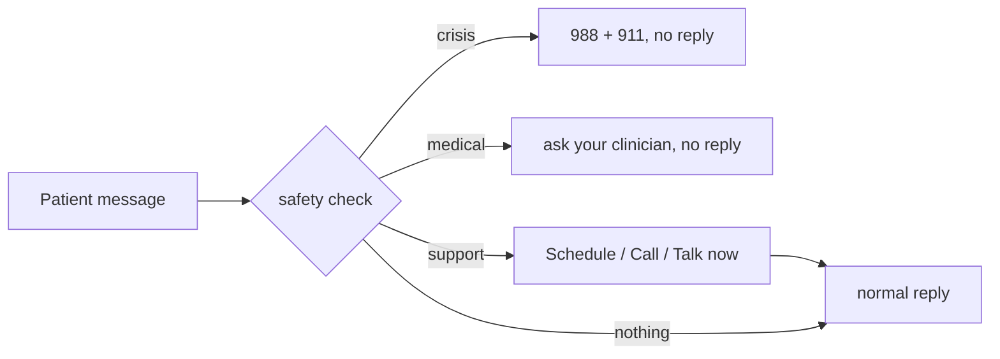

# api-gateway

The only service the frontend calls. v0 (MS2): every endpoint from `docs/contracts/api-gateway.openapi.yaml` exists with the right shapes and status codes, but returns fake data. The real CV call, safety check, fusion and LLM call arrive in MS3.

## Run locally

```bash
uv sync
uv run uvicorn app.main:app --port 8000 --reload
```

Interactive API docs: http://localhost:8000/docs. Click **Authorize** and enter a demo token:

| User | Email | Token |
|---|---|---|
| Dr. Ada Chen (clinician) | `clinician.ada@example.test` | `dev-clinician-token` |
| Alex Rivera (patient) | `patient.alex@example.test` | `dev-patient-token` |
| Bri Santos (patient) | `patient.bri@example.test` | `dev-patient-b-token` |

Or get the token from `POST /auth/login` with one of these emails and the demo password.

## Endpoints (v0)

| Endpoint | Returns |
|---|---|
| `GET /health` | `ok` / `degraded` + each dependency (`cv-service`, `llm-service`, `db`); always 200, which keeps Docker from restarting the gateway when a dependency is down |
| `POST /auth/login` | demo users from `services/db/seed.sh` with password `MIRROR_DEMO_PASSWORD`; returns their token, role and `user_id`; 401 if the email or password is wrong (real auth: M4-02) |
| `POST /sessions` | 201, in-memory session (database: MS3) |
| `POST /sessions/{id}/frames` | 202; frame read and discarded, never stored; 409 without camera consent; 415 if not JPEG; 413 if larger than MAX_FRAME_BYTES |
| `POST /sessions/{id}/messages` | Server-Sent Events: `token` events (`{"text": ...}`) then `done`; a `support` event first when the patient asks for a person or can't cope; or a single `crisis` / `medical` event instead of the reply (M3-07) |

Errors: 401 no/invalid token or wrong login, 403 wrong role or not your session, 404 unknown session, 409 no camera consent, 413 frame too large, 415 not a JPEG, 422 malformed request.

## Configuration (environment variables)

| Variable | Default |
|---|---|
| `APP_NAME` | `mirror-api-gateway` |
| `LOG_LEVEL` | `INFO` |
| `CV_SERVICE_URL` | `http://cv-service:8001` |
| `LLM_SERVICE_URL` | `http://llm-service:8002` |
| `DB_HOST` / `DB_PORT` | `db` / `5432` |
| `DEPENDENCY_TIMEOUT_S` | `2.0` |
| `MAX_FRAME_BYTES` | `1000000` |
| `MIRROR_DEMO_PASSWORD` | `mirror-demo` (local demo only; same variable as `services/db`) |
| `CORS_ORIGINS` | `["http://localhost:3000","http://localhost:8080"]` |
| `CLINIC_BOOKING_URL` | empty (hides the Schedule button) |
| `CLINIC_PHONE` | empty (hides the Call button) |
| `LIVE_SUPPORT_AVAILABLE` | `false` |

Defaults use docker-compose service names. No secrets needed in v0. All variables are listed in `.env.example`; copy it to `.env` only for local overrides (never commit `.env`).

## Safety check (M3-07)

Before Mirror replies, `app/safety.py` reads the patient's message and decides one of four things:

| The patient writes... | Mirror does | Clinician flag |
|---|---|---|
| something about suicide, self-harm or hurting someone ("I want to die") | **Crisis:** shows 988 and 911 and does not reply | urgent |
| a medical question ("can I take ibuprofen with my zoloft?") | **Medical:** says to ask their clinician or pharmacist and does not reply | none |
| a need for a person ("can I talk to a real person?", "I can't cope") | **Support:** shows Schedule / Call / Talk-now buttons, then replies as usual | routine |
| anything else | replies as usual | none |



### Why simple rules and not a model

- The same message always gets the same answer, which makes it easy to test.
- The team can read and review every rule.
- It does not depend on the LLM; tuning the persona can't weaken it.
- It reads only the text, never the face.

### Why the support tier

Mirror is used between sessions, when an appointment isn't available. Most hard moments are not a crisis, but the patient should still see that a real person is part of their care. The support note keeps them talking and puts the clinic one tap away. The buttons come from settings:

| Setting | Button |
|---|---|
| `CLINIC_BOOKING_URL` | Schedule an appointment |
| `CLINIC_PHONE` | Call the office |
| `LIVE_SUPPORT_AVAILABLE=true` | Talk to someone now (off in the prototype: no staff behind it) |

An empty setting hides its button. Mirror never shows a made-up number or link.

### Where things are

| What | Where |
|---|---|
| The rules | top of `app/safety.py` (`CRISIS_RULES`, `MEDICAL_RULES`, `SUPPORT_RULES`) |
| Harmless look-alikes ("this commute is killing me") | `CRISIS_EXCEPTIONS` in `app/safety.py` |
| Where the check runs | `send_message` in `app/chat.py` |
| Test messages | `tests/safety_cases.yaml` (66 messages) |
| Event shapes | `docs/contracts/api-gateway.openapi.yaml` (`CrisisPayload`, `MedicalPayload`, `SupportPayload`) |

### Changing a rule

1. Add the message to `tests/safety_cases.yaml` with the outcome you expect.
2. Edit the rule in `app/safety.py`.
3. Run `uv run pytest tests/test_safety.py -q` until it passes, then open a PR.

When unsure, let the crisis rule fire: an extra 988 screen costs a moment; a missed crisis costs much more.

### Good to know

- Logs and flags never contain the message text, only which rule fired.
- Flags are kept in memory for now; M3-10 saves them to the database.
- English only.
- The chat screen doesn't show the medical and support events yet (M3-12).

## Checks

```bash
uv run ruff check .
uv run pytest -q
```

## Docker

Build and run from this directory:

```bash
docker build -t mirror-api-gateway .
docker run --rm -p 8000:8000 mirror-api-gateway
```

Check it from a second terminal:

```bash
curl -f http://localhost:8000/health
```

Run on its own, `/health` reports `degraded` because cv-service, llm-service and db aren't running. That's expected: the status code is still 200 and the container stays healthy. Inside docker-compose (M2-03) the dependencies resolve by service name.
