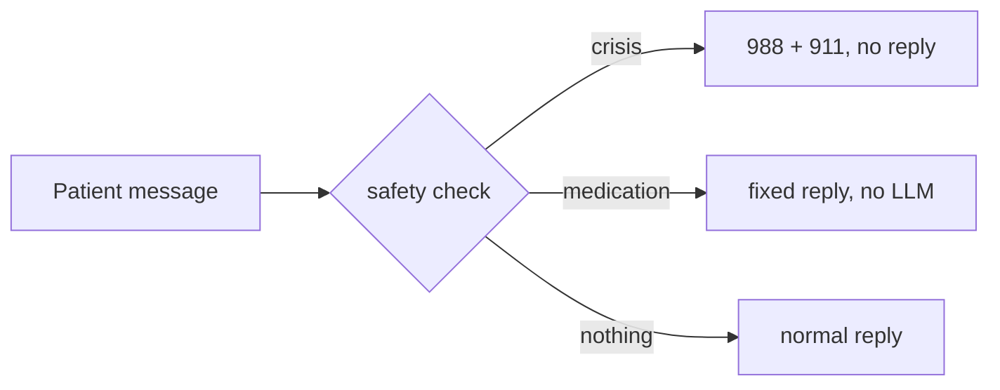

# api-gateway

The only service the frontend calls. v0 (MS2): every endpoint from `docs/contracts/api-gateway.openapi.yaml` exists with the right shapes and status codes, but returns fake data. The real CV call, safety check, fusion and LLM call arrive in MS3.

## Run locally

```bash
uv sync
uv run uvicorn app.main:app --port 8000 --reload
```

Interactive API docs: http://localhost:8000/docs. Click **Authorize** and enter a demo token:

| User | Email | Token |
|---|---|---|
| Dr. Ada Chen (clinician) | `clinician.ada@example.test` | `dev-clinician-token` |
| Alex Rivera (patient) | `patient.alex@example.test` | `dev-patient-token` |
| Bri Santos (patient) | `patient.bri@example.test` | `dev-patient-b-token` |

Or get the token from `POST /auth/login` with one of these emails and the demo password.

## Endpoints (v0)

| Endpoint | Returns |
|---|---|
| `GET /health` | `ok` / `degraded` + each dependency (`cv-service`, `llm-service`, `db`); always 200, which keeps Docker from restarting the gateway when a dependency is down |
| `POST /auth/login` | demo users from `services/db/seed.sh` with password `MIRROR_DEMO_PASSWORD`; returns their token, role and `user_id`; 401 if the email or password is wrong (real auth: M4-02) |
| `POST /sessions` | 201, in-memory session (database: MS3) |
| `POST /sessions/{id}/frames` | 202; frame read and discarded, never stored; 409 without camera consent; 415 if not JPEG; 413 if larger than MAX_FRAME_BYTES |
| `POST /sessions/{id}/messages` | Server-Sent Events: `token` events (`{"text": ...}`) then `done`; or a single `crisis` event instead of the reply (M3-07) |

Errors: 401 no/invalid token or wrong login, 403 wrong role or not your session, 404 unknown session, 409 no camera consent, 413 frame too large, 415 not a JPEG, 422 malformed request.

## Configuration (environment variables)

| Variable | Default |
|---|---|
| `APP_NAME` | `mirror-api-gateway` |
| `LOG_LEVEL` | `INFO` |
| `CV_SERVICE_URL` | `http://cv-service:8001` |
| `LLM_SERVICE_URL` | `http://llm-service:8002` |
| `DB_HOST` / `DB_PORT` | `db` / `5432` |
| `DEPENDENCY_TIMEOUT_S` | `2.0` |
| `MAX_FRAME_BYTES` | `1000000` |
| `MIRROR_DEMO_PASSWORD` | `mirror-demo` (local demo only; same variable as `services/db`) |
| `CORS_ORIGINS` | `["http://localhost:3000","http://localhost:8080"]` |

| `TEXT_EMOTION_MODEL` | `j-hartmann/emotion-english-distilroberta-base` (D-003) |
| `TEXT_EMOTION_REVISION` | `0e1cd914e3d46199ed785853e12b57304e04178b` (pinned Hugging Face commit, see Model pin) |
| `TEXT_EMOTION_MAX_CHARS` | `2000` |

Defaults use docker-compose service names. No secrets needed in v0. All variables are listed in `.env.example`; copy it to `.env` only for local overrides (never commit `.env`).

## Safety check (M3-07)

Before Mirror replies, `app/safety.py` reads the patient's message:

| The patient writes... | Mirror does | Clinician flag |
|---|---|---|
| something about suicide, self-harm or hurting someone ("I want to die") | **Crisis:** shows 988 and 911 and does not reply | urgent |
| a medication decision ("should I stop my meds?", "how many mg is safe?") | **Medication (M3-09):** sends a fixed reply pointing to their prescriber or a pharmacist; the LLM is not called | none |
| anything else | replies as usual | none |



### Why simple rules and not a model

- The same message always gets the same answer, which makes it easy to test.
- The team can read and review every rule.
- It does not depend on the LLM; tuning the persona can't weaken it.
- It reads only the text, never the face.

### Where things are

| What | Where |
|---|---|
| The rules | top of `app/safety.py` (`CRISIS_RULES`, `MEDICATION_RULES`) |
| Harmless look-alikes ("this commute is killing me") | `CRISIS_EXCEPTIONS`, `MEDICATION_EXCEPTIONS` in `app/safety.py` |
| The medication reply | `MEDICATION_REPLY` in `app/safety.py`; sent as normal `token` + `done` events, no contract change |
| Where the check runs | `send_message` in `app/chat.py` |
| Test messages | `tests/safety_cases.yaml` (116 messages) |
| Event shape | `docs/contracts/api-gateway.openapi.yaml` (`CrisisPayload`) |

### Changing a rule

1. Add the message to `tests/safety_cases.yaml` with the outcome you expect.
2. Edit the rule in `app/safety.py`.
3. Run `uv run pytest tests/test_safety.py -q` until it passes, then open a PR.

When unsure, let the crisis rule fire: an extra 988 screen costs a moment; a missed crisis costs much more.

### Good to know

- Logs and flags never contain the message text, only which rule fired.
- Crisis replies always provide 988/911 guidance. If PostgreSQL is unreachable, the gateway cannot create a durable review flag and must not claim that a clinician has been notified; the patient still receives the crisis guidance.
- English only.
- Crisis is checked first: "how many pills to overdose" is a crisis, not a dosing question.
- The medication rules catch a request for a decision, not every mention: "my sertraline makes me tired" gets a normal reply, and the prompt still tells the LLM never to talk about doses.
- Prototype on demo data only: built with HIPAA-style safeguards (only the patient's own clinician can see their data, no message text in logs, no camera frames, HTTPS, encrypted storage), but not a HIPAA-compliant product.

## Text-emotion module (M3-05)

`app/text_emotion.py` turns one chat message into the two most likely emotions, in the shape the context object uses for `text.top2` (`docs/contracts/context_object.schema.json`):

```python
from app.text_emotion import get_text_emotion

result = get_text_emotion().analyse("I had a really rough day")
result.as_context()   # {"top2": [["sadness", 0.71], ["fear", 0.12]]}
result.latency_ms     # time spent scoring this message
```

- **Model:** `j-hartmann/emotion-english-distilroberta-base`, chosen in M2-11 (D-003 in `docs/decisions.md`). Its 7 labels are the same as the camera model's: face and text can be compared in fusion (M3-06).
- **CPU only.** torch comes from the CPU wheel index (as in cv-service); the image doesn't carry CUDA.
- **Loaded during gateway startup:** the gateway warms the locally available pinned model before it accepts requests, so the first patient message does not pay the lazy-load delay. Startup never downloads model/data: pre-provision the pinned model cache (`HF_HOME`) on the host. If it is absent or cannot load, startup logs only the failure type and chat remains safely text-only.
- **Model pin:** `TEXT_EMOTION_REVISION` defaults to Hugging Face commit `0e1cd914e3d46199ed785853e12b57304e04178b` (the model's latest commit, Jan 2, 2023), not `main`: a rebuild can never silently load different weights. **Deployment handoff:** the VM and docker-compose use this default; do not set `TEXT_EMOTION_REVISION=main` anywhere. To move to a newer model commit, change the default here, in `app/config.py` and in `.env.example` in one PR, and re-run the D-003 evaluation and the latency check before merging.
- **Failure:** if the model can't load or run, `analyse()` raises `TextEmotionUnavailable`. The chat endpoint (M3-10) should then carry on without a text signal (fallback paths: M4-04).
- **Safety:** this module only describes tone. The crisis check (M3-07) runs before it and never depends on it.
- **Privacy:** message text is never logged, only the top label and latency.

Tests: `tests/test_text_emotion.py` uses a fake classifier and runs in CI with no download. The real-model latency check (target: p95 < 100 ms per message on CPU) runs only when asked:

```bash
RUN_MODEL_TESTS=1 uv run pytest tests/test_text_emotion_model.py -q -s
```

## Smoothing and gating (M3-04)

`app/gating.py` keeps the last 10 s of cv-service readings per session (probabilities only, never frames) and reports `ok`, `uncertain`, `dropped` or `camera_off`. "ok" needs the averaged top emotion to reach `GATE_MIN_TOP_PROB` (0.45), lead the second by `GATE_MIN_MARGIN` (0.05), and be the top emotion in `GATE_MIN_STABILITY` (0.50) of the frames.

**Provisional (experimental) thresholds.** They were tuned with `cv-vit-b16-v4`, the served model, on Aff-Wild2 video rather than our own users. Treat them as a starting point until the served model changes or our own labelled sessions (M3-20) exist; then re-run the sweep.

**How they were chosen:** `scripts/gate_sweep.py` replays the 36 held-out Aff-Wild2 validation videos at 1 frame per second (1,951 ten-second windows) through the real `gate()`, scored by the current CV model (`cv-vit-b16-v4`, per-frame scores from `pipelines/cv-eval/scripts/export_frame_probs.py`), and tries 80 combinations ([W&B](https://wandb.ai/mog941-harvard-university/mirror/runs/dposf012)).

| Thresholds (top / margin / stability) | "ok" in | right when "ok" |
|---|---|---|
| 0.30 / 0.05 / 0.50 (loose) | 71 % of windows | 54 % |
| 0.40 / 0.10 / 0.60 (first guess) | 47 % | 59 % |
| **0.45 / 0.05 / 0.50 (chosen)** | **31 %** | **64 %** |
| 0.50 / 0.05 / 0.50 (strict) | 14 % | 69 % |

A single frame without the gate is right 50 % of the time. We chose fewer but more reliable face signals: a wrong hint is worse than none, because Mirror then relies on the text. When the gate says "ok" it reports almost only neutral, happy or surprise; it is almost never "ok" for angry, sad, fear or disgust, so fusion (M3-06) should not let the face lead on those.

**Safety:** out-of-range settings (a probability outside 0-1, a non-positive window or frame count, `GATE_MAX_FRAMES` below `GATE_MIN_FRAMES`) stop the gateway at startup. A cv-service reading without exactly the 7 labels, each a number between 0 and 1, is treated as a frame without a face, so a broken reply ends in `dropped`, never a crash.

Re-run after a model change: export the frame scores with the new checkpoint, then `uv run --with wandb python -m scripts.gate_sweep <frames.csv> --wandb-project mirror`.

## Fusion (M3-06)

`app/fusion.py` turns the gated face reading (M3-04) and the text reading (M3-05) into one context object per turn (`docs/contracts/context_object.schema.json`). It follows D-004: when face and words disagree, the more concerning signal leads and Mirror checks in once.

| Situation | Main signal (`note`) | `agreement` |
|---|---|---|
| Words negative (anger, disgust, fear, sadness) | text, whatever the face shows | agree if the face is also negative, else disagree |
| Words calm or unclear, face ok and neutral/happy/surprise | face | agree / disagree |
| Face ok but negative, words calm | text | **disagree, on purpose** (see below) |
| Face uncertain, dropped or camera off | text (or none if the words are unclear, prob < 0.40) | n/a |
| A second disagreement in the same session | as above | n/a, note ends "already checked in this session" |

- **A negative face never leads:** the M3-04 sweep showed the gate is almost never right about angry, disgust, fear or sad. It still counts for `agreement`, so a negative face with calm words makes Mirror check in gently. That is the safe direction; please don't "fix" it.
- **Tone:** `supportive` by default; `coach` only after 2 of the last 3 turns were steady (a signal, nothing negative), and back to supportive on any negative turn.
- **Once per turn:** `fuse()` only reads the session's `TurnHistory`, so a retry is safe. Call `history.record(context)` once, when the turn's reply is final.

## Metrics (M3-15)

`GET /metrics` serves Prometheus text format (`app/metrics.py`, `prometheus-client`), for the monitoring dashboard (M4-08):

| Metric | Labels | What it counts |
|---|---|---|
| `mirror_gateway_requests_total` | `route`, `method`, `status` | every HTTP request; `route` is the pattern (`/sessions/{session_id}/messages`), never a real session id; `method` is a standard one or `invalid` |
| `mirror_gateway_request_seconds` | `route` | time to answer (for streams: until the first byte); histogram, so p50/p95 can be computed |
| `mirror_gateway_crisis_hits_total` | `rule` | crisis-check hits by rule id (never the message text) |
| `mirror_gateway_medication_hits_total` | `rule` | medication questions answered with the fixed reply, by rule id |
| `mirror_gateway_text_emotion_seconds` | | time to score one message |
| `mirror_gateway_text_emotion_unavailable_total` | | messages that went on without a text reading (fallback) |
| `mirror_gateway_gate_total` | `status` | gate outcome per turn (ok / uncertain / dropped / camera_off) |
| `mirror_gateway_fusion_total` | `agreement`, `tone_mode`, `main_signal` | fusion outcome per turn |

Errors are the requests with a 5xx `status`. The gate and fusion counters fill once the chat endpoint (M3-10) calls `metrics.record_gate(status)` and `metrics.record_fusion(agreement, tone_mode, main_signal)`, one line each, where it calls `gate()` and `fuse()`. Label values come from fixed lists (`app/metrics.py`); anything else is counted as `invalid`, so no free text ever becomes a label.

`/metrics` is not public: Caddy answers `/api/metrics` with 404 (`infra/caddy/Caddyfile`, checked by `tests/test_metrics.py`). A Prometheus server will scrape the gateway directly on the private network (M4-08). Every log line already carries the request's `request_id` (JSON logs).

## Checks

```bash
uv run ruff check .
uv run pytest -q
```

## Prompt template (M3-08)

`app/prompt.py` turns the context object and the patient's message into the messages the gateway sends to llm-service. It sits in the gateway because the gateway owns the context object (`docs/architecture.md`); llm-service stays a plain model server.

Each turn the model gets:

1. Fixed rules: 2 to 4 sentences (never one), reflect first, no assumptions or leading questions, at most one question, says plainly it is not a real person or a clinician, no medical advice, never mentions cameras or numbers. If asked what the camera or software sees, it reports no reading and asks how they feel; it never names a feeling the signals do not give.
2. The mode from fusion (M3-06): **supportive** by default, **coach** only after steady turns.
3. This turn's signals in plain words, for example:
   - `Face: their expression may look sad. This is an estimate.`
   - `Face: the camera is off. Do not mention facial expression.`
   - `The face and the words point in different directions. Lean towards the more concerning one and gently check in now ...` (D-004; fusion decides when, the prompt only words it)
4. The last 6 messages, then the patient's new message.

- **Words, not numbers:** "0.46 sad" invites the model to say "you are 46% sad". A plain word plus "this is an estimate" keeps it guessing and asking.
- **Weak readings are hidden:** a top label under 0.40 or an unknown label becomes "unclear". An `uncertain`, `dropped` or `camera_off` face always becomes "do not mention facial expression", even if the patient asks about it. An unknown label never breaks the turn.
- **Safety:** the patient's text only goes in the `user` message, and the history can't carry a `system` message. The crisis check (M3-07) runs first.

Review the 20 sample cases (`tests/prompt_cases.json`):

```bash
uv run python -m scripts.prompt_samples > prompt_samples.md                                # prompts only
uv run python -m scripts.prompt_samples --llm-url http://localhost:8002 > prompt_samples.md  # with Mirror's replies
```

## Docker

Build and run from this directory:

```bash
docker build -t mirror-api-gateway .
docker run --rm -p 8000:8000 mirror-api-gateway
```

Check it from a second terminal:

```bash
curl -f http://localhost:8000/health
```

Run on its own, `/health` reports `degraded` because cv-service, llm-service and db aren't running. That's expected: the status code is still 200 and the container stays healthy. Inside docker-compose (M2-03) the dependencies resolve by service name.
