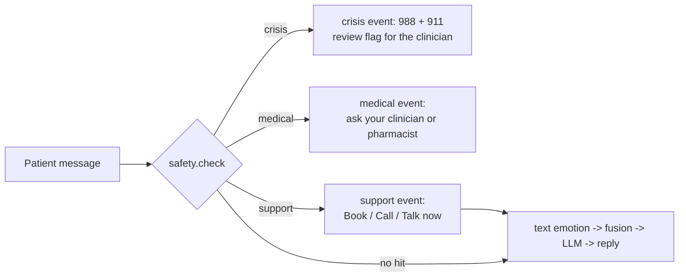

# api-gateway

The only service the frontend calls. v0 (MS2): every endpoint from `docs/contracts/api-gateway.openapi.yaml` exists with the right shapes and status codes, but returns fake data. The real CV call, safety check, fusion and LLM call arrive in MS3.

## Run locally

```bash
uv sync
uv run uvicorn app.main:app --port 8000 --reload
```

Interactive API docs: http://localhost:8000/docs. Click **Authorize** and enter a demo token:

| User | Email | Token |
|---|---|---|
| Dr. Ada Chen (clinician) | `clinician.ada@example.test` | `dev-clinician-token` |
| Alex Rivera (patient) | `patient.alex@example.test` | `dev-patient-token` |
| Bri Santos (patient) | `patient.bri@example.test` | `dev-patient-b-token` |

Or get the token from `POST /auth/login` with one of these emails and the demo password.

## Endpoints (v0)

| Endpoint | Returns |
|---|---|
| `GET /health` | `ok` / `degraded` + each dependency (`cv-service`, `llm-service`, `db`); always 200, which keeps Docker from restarting the gateway when a dependency is down |
| `POST /auth/login` | demo users from `services/db/seed.sh` with password `MIRROR_DEMO_PASSWORD`; returns their token, role and `user_id`; 401 if the email or password is wrong (real auth: M4-02) |
| `POST /sessions` | 201, in-memory session (database: MS3) |
| `POST /sessions/{id}/frames` | 202; frame read and discarded, never stored; 409 without camera consent; 415 if not JPEG; 413 if larger than MAX_FRAME_BYTES |
| `POST /sessions/{id}/messages` | Server-Sent Events: `token` events (`{"text": ...}`) then `done`; or a single `crisis` / `medical` event when the safety check fires (M3-07) |

Errors: 401 no/invalid token or wrong login, 403 wrong role or not your session, 404 unknown session, 409 no camera consent, 413 frame too large, 415 not a JPEG, 422 malformed request.

## Configuration (environment variables)

| Variable | Default |
|---|---|
| `APP_NAME` | `mirror-api-gateway` |
| `LOG_LEVEL` | `INFO` |
| `CV_SERVICE_URL` | `http://cv-service:8001` |
| `LLM_SERVICE_URL` | `http://llm-service:8002` |
| `DB_HOST` / `DB_PORT` | `db` / `5432` |
| `DEPENDENCY_TIMEOUT_S` | `2.0` |
| `MAX_FRAME_BYTES` | `1000000` |
| `MIRROR_DEMO_PASSWORD` | `mirror-demo` (local demo only; same variable as `services/db`) |
| `CORS_ORIGINS` | `["http://localhost:3000","http://localhost:8080"]` |
| `CLINIC_BOOKING_URL` | empty (the clinic's booking page for the support note; empty hides the button) |
| `CLINIC_PHONE` | empty (the office phone for the support note; empty hides the button) |
| `LIVE_SUPPORT_AVAILABLE` | `false` (`true` only while a staff member is on hand to talk live) |

Defaults use docker-compose service names. No secrets needed in v0. All variables are listed in `.env.example`; copy it to `.env` only for local overrides (never commit `.env`).

## Safety check (M3-07)

Every patient message goes through `app/safety.py` **first**, before text emotion, fusion or the LLM. A crisis or medical hit stops the turn and the persona never replies. A support hit offers the patient a real person first, then the conversation continues.

It is plain rules (regular expressions), not a model, on purpose:

- the same message always gets the same answer, which makes it exactly testable;
- every rule can be read and reviewed by the team;
- style tuning of the LLM (our LoRA) can weaken a model's own refusals; safety must therefore not depend on the LLM.

The face signal is **never** an input: a sad face must not trigger a crisis screen, and a neutral face must not hide one.



### What the patient gets

| Outcome | Fires on | Stream | Review flag |
|---|---|---|---|
| `crisis` | suicide, self-harm, harming someone else | one `crisis` event, then the stream ends | yes, urgent |
| `medical` | doses, mixing or stopping medication, asking for a diagnosis | one `medical` event, then the stream ends | no |
| `support` | asking for a real person or an appointment; "I can't cope", "everything is falling apart" | one `support` event, then the normal reply (`token` … `done`) | yes, routine |
| no hit | everything else | `token` events, then `done` (normal reply) | no |

Example crisis turn (shape from `docs/contracts/api-gateway.openapi.yaml`, `CrisisPayload`):

```text
event: crisis
data: {"message": "It sounds like you're carrying something really painful right now...",
       "resources": [{"name": "988 Suicide & Crisis Lifeline", "contact": "call or text 988"},
                     {"name": "Emergency services", "contact": "call 911 if you are in immediate danger"}],
       "review_flag_created": true}
```

Example medical turn (`MedicalPayload`, added in M3-07):

```text
event: medical
data: {"message": "That's a question about medicine or a diagnosis, and I can't give medical advice. ..."}
```

Example support turn (`SupportPayload`, added in M3-07). The note comes first and the persona reply follows:

```text
event: support
data: {"message": "It sounds like a lot right now. I'm here to keep talking with you, and your clinician is the best person to help with this. ...",
       "actions": [{"type": "schedule", "label": "Book an appointment", "url": "<CLINIC_BOOKING_URL>"},
                   {"type": "call", "label": "Call the office", "contact": "<CLINIC_PHONE>"},
                   {"type": "live", "label": "Talk to someone now", "available": false}]}

event: token
data: {"text": "..."}
```

### Why there is an in-between tier

Mirror is for the time between sessions, when a one-on-one appointment isn't available. Most hard moments are not a crisis, but the patient still needs to know a person is part of their care. The support tier keeps them talking with Mirror and, in the same turn, puts the clinic one tap away:

- **Book an appointment** opens the clinic's scheduler (`CLINIC_BOOKING_URL`).
- **Call the office** shows the front desk number (`CLINIC_PHONE`).
- **Talk to someone now** is a live hand-off to a staff member. The prototype has no staff behind it: the action is sent with `available: false` and the chat screen hides it. A real practice sets `LIVE_SUPPORT_AVAILABLE=true` during staffed hours.

Buttons appear only for what the clinic has configured. Mirror never shows a made-up number or link.

### How a message is checked

1. **Normalise:** lower-case, curly apostrophes become straight ones, punctuation becomes spaces, repeated spaces collapse. This way, `I’M GOING TO END MY LIFE!!!` and `i'm going to end my life` are checked the same way.
2. **Crisis rules first.** Crisis always wins: "how many pills would it take to overdose" is crisis, not medical.
3. **Idiom exceptions.** Some rules have harmless look-alikes ("this commute is killing me", "my mom is going to kill me", "I hurt myself at the gym"). Before a rule runs, *only those phrases* are blanked out of the text; the rest of the message is still checked. For example, "I want to kill myself, this week is killing me" still fires.
4. **Medical rules** run only if no crisis rule fired, and **support rules** only if neither did.
5. The first matching rule's id is returned (for example `crisis / not-alive`).

### The rules

| Kind | Rule id | Catches (examples) |
|---|---|---|
| crisis | `suicide-word` | "suicide", "suicidal thoughts" |
| crisis | `kill-self` | "kill myself" |
| crisis | `end-life` | "end my life", "take my own life" |
| crisis | `want-die` | "I want to die", "I wish I could just die" |
| crisis | `better-dead` | "better off dead", "better off without me" |
| crisis | `not-alive` | "I don't want to be alive / wake up" |
| crisis | `no-reason-live` | "no reason to live", "nothing left to live for" |
| crisis | `not-here` | "I won't be around much longer" |
| crisis | `self-harm` | "cutting myself", "hurt myself on purpose", "self-harm" |
| crisis | `overdose` | "overdose", "OD on" |
| crisis | `cant-go-on` | "I can't go on like this" |
| crisis | `goodbye-note` | "goodbye letter", "goodbye note" |
| crisis | `harm-other` | "kill my neighbour", "stabbing someone" |
| crisis | `hurt-other` | "I want to hurt him" |
| medical | `dose` | "how many mg of melatonin", "max dose of tylenol" |
| medical | `mix-meds` | "can I take ibuprofen with my zoloft" |
| medical | `stop-meds` | "should I stop taking my meds", "double my dose" |
| medical | `diagnose` | "do I have ADHD?", "am I bipolar" |
| medical | `prescribe` | "which medication should I take" |
| support | `real-person` | "can I talk to a real person?" |
| support | `someone-to-talk` | "I need someone to talk to" |
| support | `see-clinician` | "I want to see my therapist" |
| support | `appointment` | "can I book a session", "how do I get my next appointment" |
| support | `cant-cope` | "I can't cope", "I can't take it anymore" |
| support | `overwhelmed` | "everything is falling apart", "I feel so overwhelmed" |
| support | `need-help` | "I really need help" (not "I need help with my homework") |

The exact patterns are in `CRISIS_RULES`, `CRISIS_EXCEPTIONS`, `MEDICAL_RULES` and `SUPPORT_RULES` at the top of `app/safety.py`.

### Review flags and logs

- On a crisis or support hit the gateway records a review flag: patient, session, message id, rule id, urgency (`urgent` for crisis, `routine` for support) and time. **It never copies the message text.** Flags live in memory (`chat.review_flags`) for now; M3-10 writes them to the `review_flags` table and sets `messages.safety_hit`, and the clinician dashboard (M4-01) shows them.
- There are no real-time alerts: a flag is for the clinician's next review, not an emergency call.
- Logs say `safety_hit kind=crisis rule=not-alive`, never the message.

### Try it

Run the gateway (see *Run locally*), then:

```bash
SID=$(curl -s -X POST localhost:8000/sessions -H "Authorization: Bearer dev-patient-token" \
  -H "Content-Type: application/json" -d '{"camera_consent": false}' | python -c "import sys, json; print(json.load(sys.stdin)['session_id'])")

curl -N -X POST localhost:8000/sessions/$SID/messages -H "Authorization: Bearer dev-patient-token" \
  -H "Content-Type: application/json" -d '{"text": "can I take ibuprofen with my zoloft?"}'
```

You should see a single `event: medical`. Try "I had a rough day" for a normal reply.

### Tests

`tests/test_safety.py` runs in CI on every change to `services/api-gateway`:

- every case in `tests/safety_cases.yaml` must pass: 66 curated messages (25 crisis, 11 medical, 10 support, 20 that must **not** fire, such as idioms and ordinary hard days);
- every rule must be matched by at least one case;
- crisis, medical, support and normal turns go end to end through `POST /sessions/{id}/messages`;
- support actions show only what the clinic configured;
- the message text never reaches the logs.

```bash
uv run pytest tests/test_safety.py -q
```

### Changing a rule

1. Add the message that was missed (or wrongly caught) to `tests/safety_cases.yaml` and run the tests: it should fail.
2. Edit the pattern in `app/safety.py` (or add an idiom to `CRISIS_EXCEPTIONS`).
3. Run the tests until everything passes, then open a PR. Safety rules always need a reviewer to read the cases, not just the code.

When in doubt, let a crisis rule fire: showing 988 to someone who didn't need it costs a moment; missing someone in crisis costs much more.

### Limits

- English only, and only what the rules spell out: paraphrases, heavy misspellings or coded language can get through. The persona prompt (M3-08) and the evaluation's harmful-completion check (M4-09) are the next layers.
- Each message is checked on its own; the check does not look at earlier messages in the session.
- It is a safety net for a course prototype, not a clinical risk assessment.
- The frontend does not show the `medical` and `support` events yet; that comes with the chat UI (M3-12).
- The `review_flags` table has no urgency column yet; M3-10 needs one (or stores only urgent flags).

## Checks

```bash
uv run ruff check .
uv run pytest -q
```

## Docker

Build and run from this directory:

```bash
docker build -t mirror-api-gateway .
docker run --rm -p 8000:8000 mirror-api-gateway
```

Check it from a second terminal:

```bash
curl -f http://localhost:8000/health
```

Run on its own, `/health` reports `degraded` because cv-service, llm-service and db aren't running. That's expected: the status code is still 200 and the container stays healthy. Inside docker-compose (M2-03) the dependencies resolve by service name.
